<p align="center">
  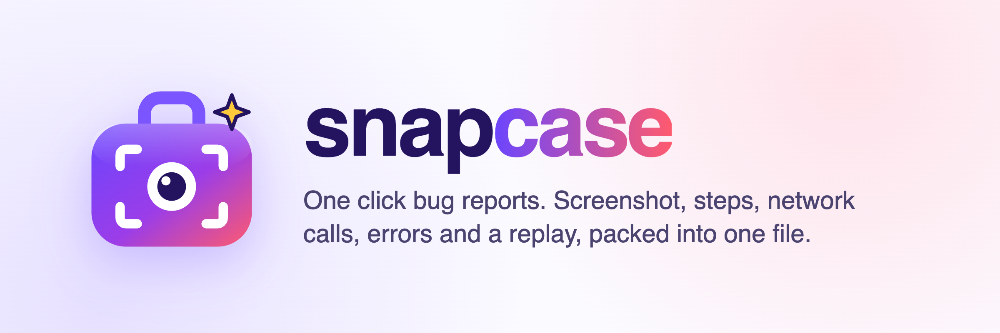
</p>

<p align="center">
  
  
  
</p>

**Snapcase** is a Chrome extension that turns "it's broken" into a report developers can act on. Click once and you get a single zip with a marked-up screenshot, the steps that led to the problem, every API call and response with timestamps, console errors, and a short replay of the page. Anyone can use it: a guided **Simple** mode for non-technical people and an **Advanced** mode for engineers.

---

## Contents

- [Why Snapcase](#why-snapcase)
- [Simple and Advanced modes](#simple-and-advanced-modes)
- [Install](#install)
- [Try it in 1 minute](#try-it-in-1-minute)
- [What's in a report](#whats-in-a-report)
- [Privacy](#privacy)
- [How it works](#how-it-works)
- [Settings](#settings)
- [Limitations](#limitations)
- [Project structure](#project-structure)
- [Development](#development)

## Why Snapcase

| Without Snapcase | With Snapcase |
| --- | --- |
| "The pay button doesn't work." | Screenshot with an arrow on the button, plus the steps taken to get there |
| "Can you open DevTools and send me the network tab?" | Every `fetch`/XHR call with headers, bodies, status and timing, plus a HAR file |
| "Any errors in the console?" | Console errors, warnings, uncaught exceptions and failed resource loads |
| "What did you click before that?" | Auto-written steps: *Clicked the "Pay now" button* |
| "I can't reproduce it." | A replay of the last 30 to 60 seconds of the page |

## Simple and Advanced modes

Switch modes with the toggle at the top of the popup, the review page or the settings page. Your choice is remembered and applies everywhere. **Both modes produce the same complete report**, so developers always get the full technical detail, whoever sent it.

### Simple (default)

One button, three guided steps, no jargon.

<p>
  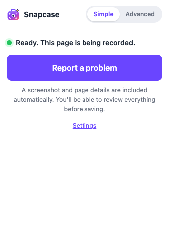
</p>

| 1. Mark the problem | 2. Describe it | 3. Save |
| --- | --- | --- |
| 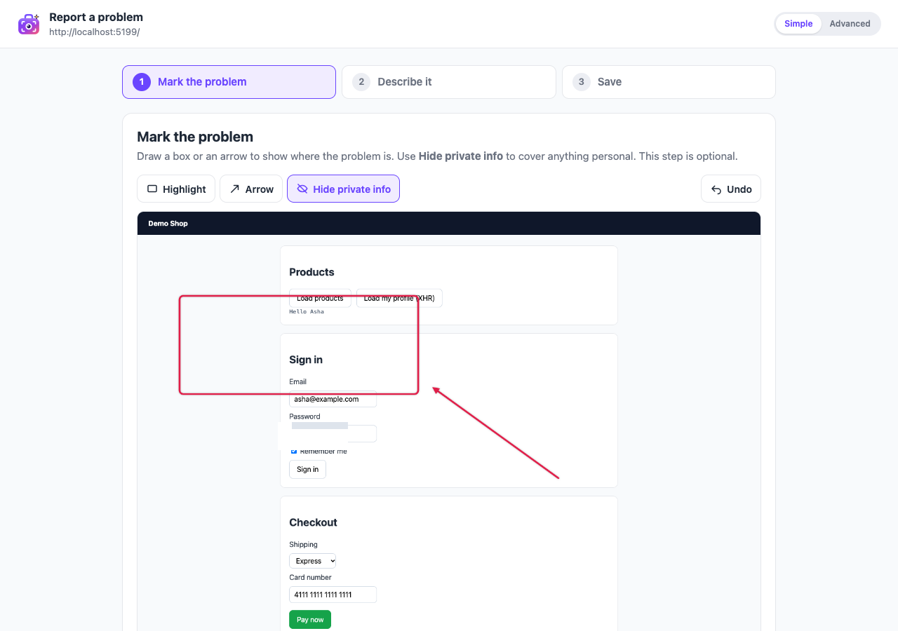 | 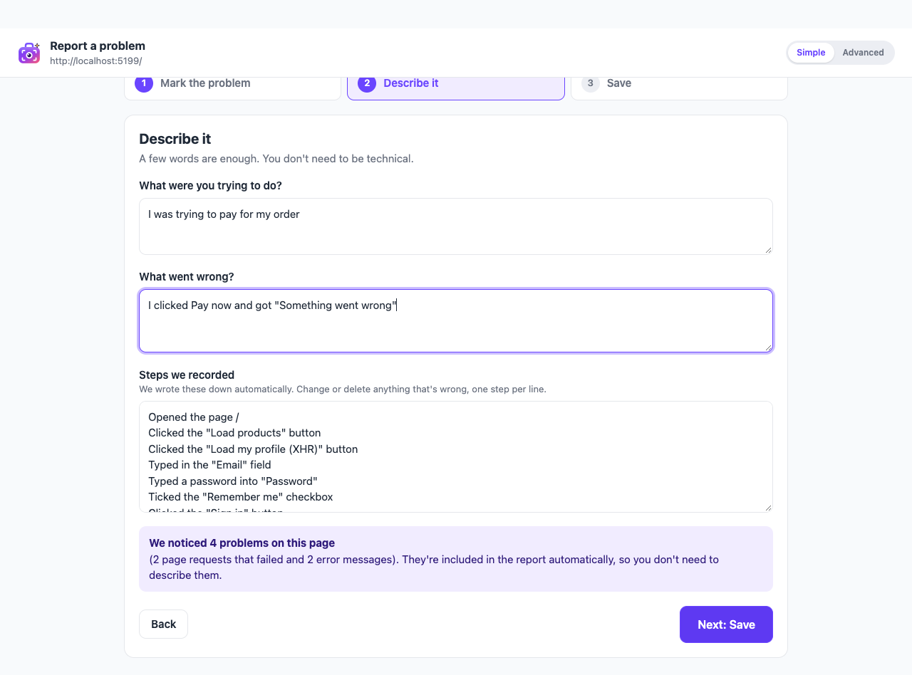 | 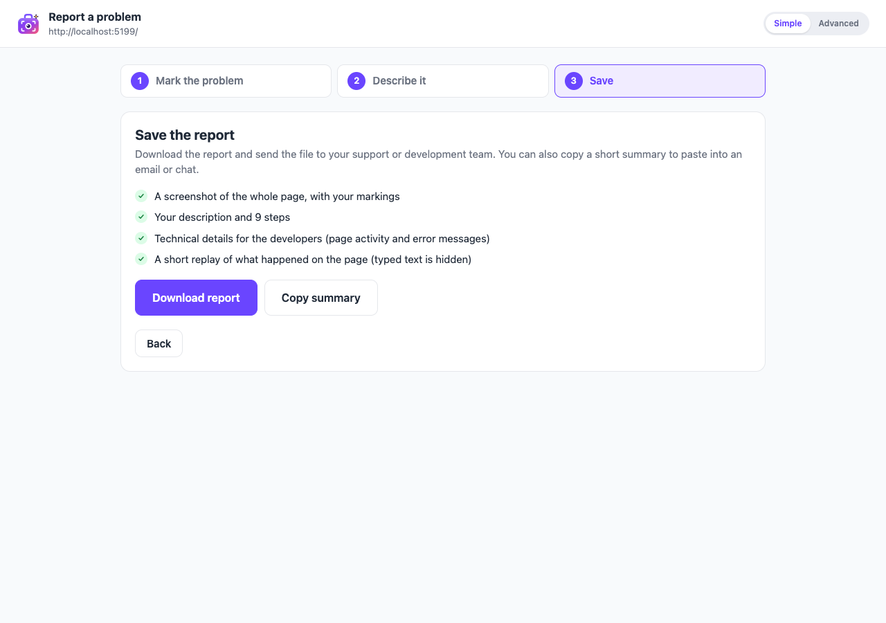 |

- Three drawing tools: **Highlight**, **Arrow**, **Hide private info**
- Two plain questions: *What were you trying to do?* and *What went wrong?*
- Steps are written automatically and can be edited
- Detected problems are explained calmly ("They're included automatically")
- No error counters on the toolbar icon

### Advanced

Everything on one screen, with the technical detail visible.

<p>
  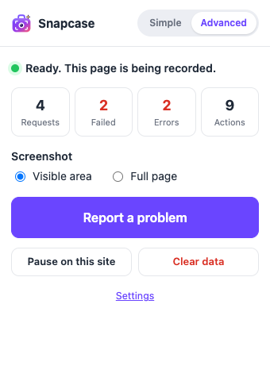
</p>

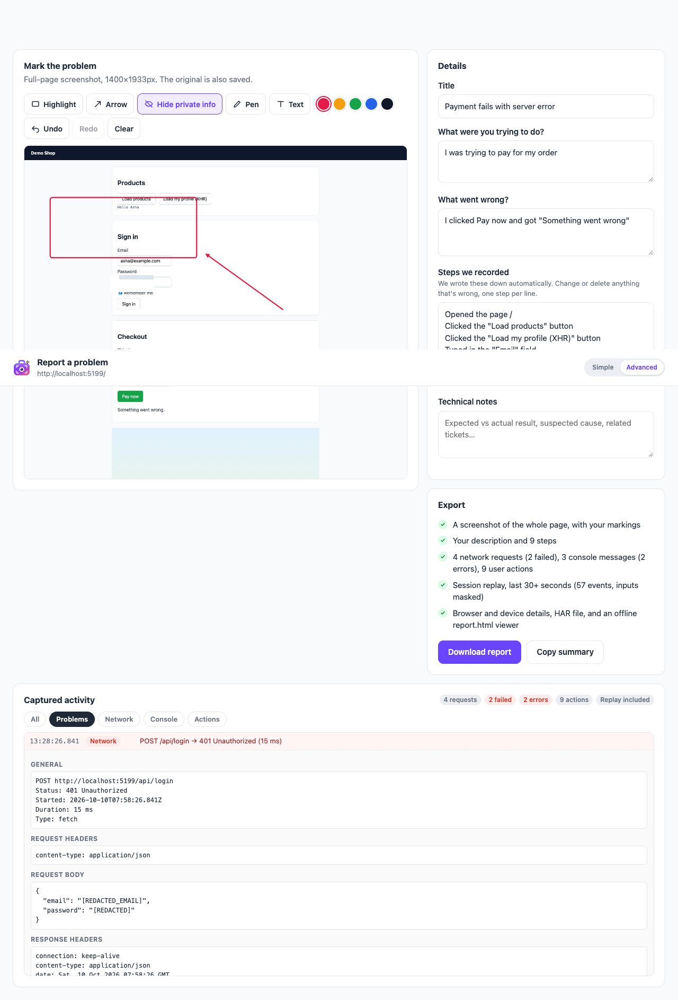

- Request, failure, error and action counts, plus a problem badge on the icon
- Visible-area or full-page screenshot
- Pen, text and colors on top of the simple tools; undo and redo
- A filterable timeline of captured activity with request and response details
- Pause recording per site, clear data, and all settings

## Install

1. Download or clone this repository.
2. Open `chrome://extensions` and turn on **Developer mode** (top right).
3. Click **Load unpacked** and select the project folder.
4. Pin **Snapcase** to the toolbar.

Tabs that were already open are picked up automatically. If the popup says a page "isn't being recorded yet", reload that page.

Requires Chrome 116 or newer (or another Chromium browser such as Edge or Brave).

## Try it in 1 minute

The repo includes a small demo shop where some actions fail on purpose:

```bash
node test/server.js
# Demo app running at http://localhost:5173
```

1. Open http://localhost:5173.
2. Click **Load products** and **Load my profile**, sign in with anything, then click **Pay now**. Payment fails with a server error and a JavaScript exception.
3. Click the Snapcase icon, then **Report a problem**.
4. Mark the screenshot, describe the problem, and click **Download report**.
5. Unzip the file and open `report.html`.

## What's in a report

Each report is a zip named `bug-report-<site>-<date>-<time>.zip`.

| File | Contents |
| --- | --- |
| `report.html` | Offline viewer with Overview, Timeline, Network, Console and Replay tabs. Opens with a double-click, no internet needed. |
| `summary.md` | Ready-to-paste ticket text (also available through **Copy summary**) |
| `screenshot.png` | The screenshot with your markings |
| `screenshot-original.png` / `screenshot-fullpage.png` | Unmarked originals |
| `network.json` / `network.har` | All requests and responses. The HAR opens in DevTools > Network > Import. |
| `console.json` | Console messages, exceptions and promise rejections with stack traces |
| `actions.json` / `navigation.json` | Clicks, typing (values hidden), selections, submits and page changes |
| `timeline.json` | Everything above merged in time order |
| `environment.json` | Browser, OS, screen, window size, language, time zone, connection, storage keys |
| `replay.json` | rrweb session replay events |
| `report.json` | Title, description, steps, counts and metadata |

### The offline viewer

| Overview | Timeline |
| --- | --- |
| 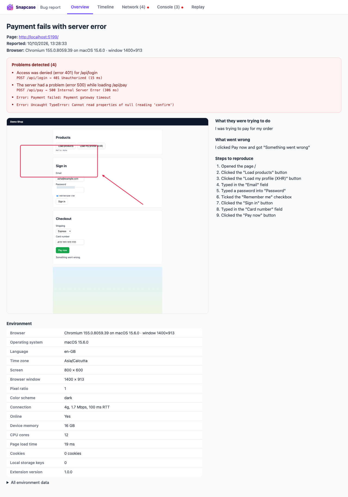 | 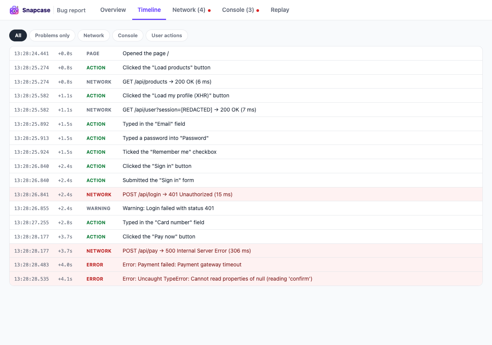 |

| Network (with Copy as cURL) | Replay |
| --- | --- |
| 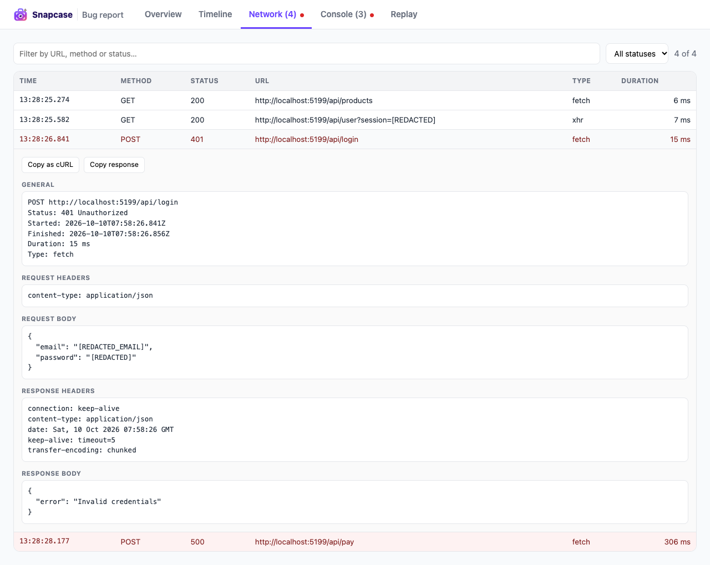 | 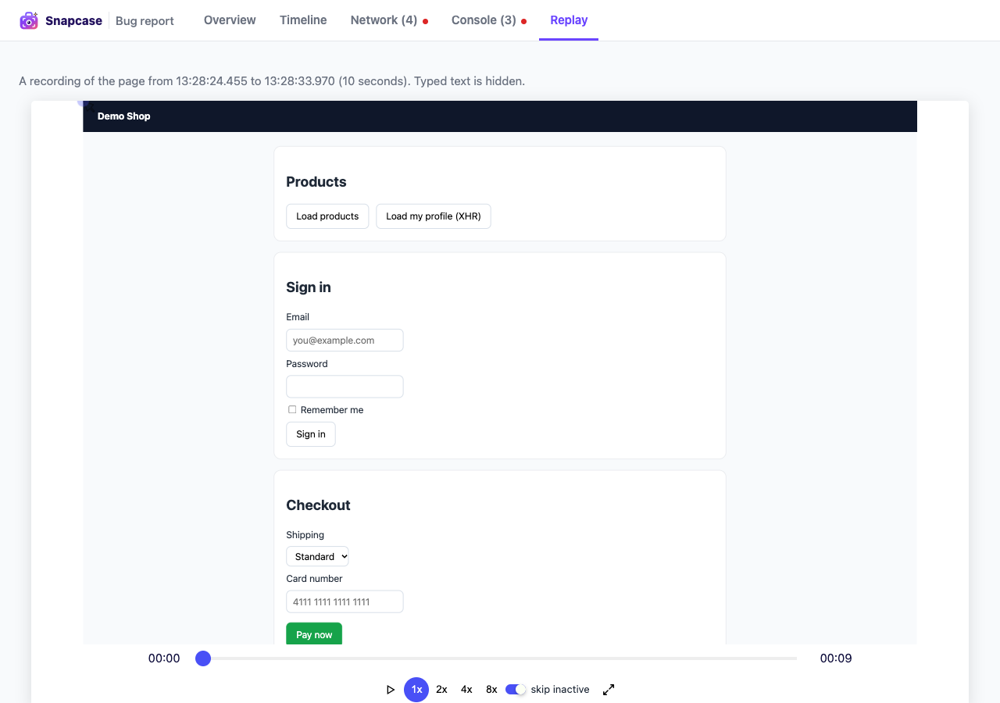 |

## Privacy

Snapcase is built to be safe to share:

- **Redaction happens before storage.** Sensitive values are replaced with `[REDACTED]` as events arrive, so they never reach memory, session storage or a report.
- **Redacted by default:**
  - `Authorization`, `Cookie`, `Set-Cookie` and API-key headers
  - JSON, form and URL fields such as `password`, `token`, `apiKey`, `secret`, `card`, `cvv`, `otp` and `pin`
  - Email addresses, JWTs and Bearer tokens
  - Card numbers (validated with the Luhn check to avoid false positives)
- **Typed text is never recorded.** The step list only notes which field was typed in and how many characters. Password fields aren't read at all. The replay masks every input.
- **Your own rules.** Add header names, field names or regex patterns in Settings.
- **The screenshot is yours to edit.** Use **Hide private info** to pixelate anything visible on screen.
- **Nothing leaves your machine.** No servers, accounts or analytics. The zip is saved to your Downloads folder and you decide who gets it.

## How it works

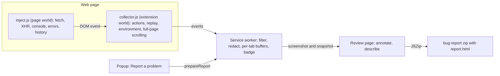

- `content/inject.js` runs in the page's own JavaScript world at `document_start` and wraps `fetch`, `XMLHttpRequest`, `console`, `history`, and the error and rejection handlers. Response bodies are read from a clone, so the page is never affected.
- `content/collector.js` runs in the extension's isolated world. It records user actions, runs the rrweb recorder in a rolling buffer, collects environment info, and scrolls the page for full-page screenshots.
- The service worker keeps a capped buffer per tab (persisted to session storage), applies domain filters and redaction, and updates the badge.
- When you report, it captures the screenshot (stitched for full page), snapshots the buffers, and opens the review page. There you annotate, describe, and export. The zip and the self-contained `report.html` are built in the browser.

## Settings

Open them from the popup (**Settings**) or with right-click on the icon > **Options**.

| Setting | Mode | Default |
| --- | --- | --- |
| Screenshot type (visible / whole page) | Simple | Visible |
| Include session replay | Simple | On |
| Problem count on the icon in Simple mode | Simple | Off |
| Replay length (30 or 60 s minimum) | Advanced | 30 s |
| Only record / never record / paused sites | Advanced | All sites |
| Ignore static files (JS, CSS, images, fonts) | Advanced | On |
| Console levels | Advanced | Errors, warnings |
| Body size, buffer sizes, max full-page height | Advanced | 100 KB, 300 requests, 500 console, 200 actions, 15000 px |
| Redaction categories, extra headers, extra fields, custom patterns | Advanced | See [Privacy](#privacy) |
| Include storage values | Advanced | Off (keys only) |

## Limitations

- Only `fetch` and `XMLHttpRequest` are captured. WebSockets, `sendBeacon`, requests made by service workers, and requests sent before the page starts are not.
- Replay and steps restart on a full page reload. Network and console logs survive reloads within the same tab.
- Full-page screenshots can show artifacts on pages with scroll animations, lazy loading, or content that scrolls inside a container.
- Chrome doesn't allow extensions on `chrome://` pages or the Chrome Web Store.

## Project structure

```
manifest.json          Extension manifest (MV3)
assets/                Logo (SVG), banner
icons/                 Toolbar and store icons (16, 32, 48, 128)
background/            Service worker: buffers, redaction, badge, screenshots, report prep
content/               inject.js (page world) and collector.js (isolated world)
shared/                Settings, mode toggle, redaction, plain-language descriptions,
                       timeline, HAR export, markdown summary, shared styles
popup/                 Toolbar popup
review/                Review page: annotation editor, wizard, zip export
report/                Template, script and styles for the offline report.html
options/               Settings page
lib/                   Vendored JSZip 3.10.2, rrweb record + player 2.1.7
test/                  Demo shop (server.js + demo.html)
docs/screenshots/      Images used in this README
```

## Development

There is no build step. Edit files, then click the reload icon on the Snapcase card in `chrome://extensions` and refresh the page you're testing.

- **Service worker logs:** `chrome://extensions` > Snapcase > *Inspect views: service worker*
- **Content scripts:** DevTools on the page > Sources > Content scripts
- **Demo app:** `node test/server.js` (set `PORT` to change the port)

### Brand

| | |
| --- | --- |
|  | **Snapcase**. A carrying case (your report) with a camera viewfinder and lens (the snap) and a flash spark. Colors: violet `#6A45FF`, purple `#9B3DE8`, coral `#FF5A6E`, ink `#24135F`, spark `#FFC93C`. Source files: `assets/logo.svg` (full) and `assets/logo-small.svg` (simplified for 16 and 32 px). |

### Third-party code

- [rrweb](https://github.com/rrweb-io/rrweb) (MIT) for session recording and replay
- [JSZip](https://github.com/Stuk/jszip) (MIT or GPLv3) for creating the zip
